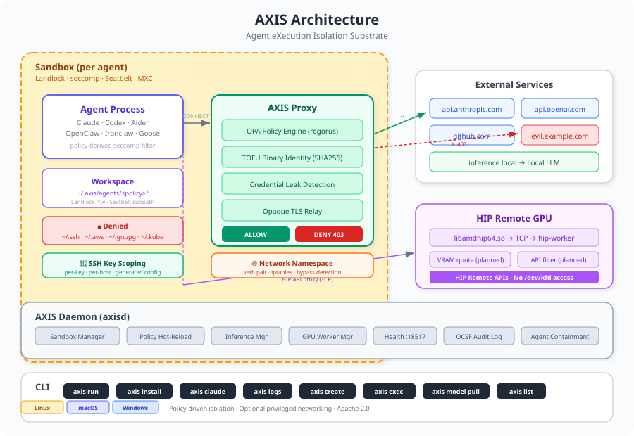

# AXIS: Agent eXecution Isolation Substrate

A high-performance agent sandbox runtime — secure, policy-governed execution for autonomous AI agents on your local hardware. The default installed Linux path uses the MXC Bubblewrap process backend with AXIS-owned policy layers and does not require admin privileges; strict Linux proxy networking may require host capabilities or the optional AXIS helper.

<p align="center">
  
</p>

## What It Does

AXIS isolates AI agent processes using OS-native primitives where the selected
platform backend is available:

| Layer | Linux | Windows | macOS |
|---|---|---|---|
| Process | MXC Bubblewrap process backend with AXIS seccomp; native Landlock/seccomp retained | Experimental: MXC ProcessContainer (BaseContainer) with AXIS-owned lifecycle cleanup | Seatbelt (sandbox-exec) |
| Filesystem | MXC Bubblewrap mounts or native Landlock LSM | MXC ProcessContainer path allowlists | Seatbelt profile (subpath rules) |
| Network | block mode, MXC cooperative proxy, or strict native netns proxy | MXC allow/block plus BaseContainer strict proxy through the installed AXIS WFP broker | Seatbelt network deny + proxy |
| GPU | Optional HIP Remote artifacts | Optional HIP Remote artifacts | Optional HIP Remote artifacts |
| Inference | Local LLM via llama.cpp or vLLM | Same | Same |

In proxy mode, allowed network requests go through a policy-evaluated proxy.
HIP Remote policies route GPU API calls to a worker process when the optional
client and worker artifacts are present.

## Install

Prebuilt archives are available for Linux x86-64, macOS Apple silicon, and
Windows x86-64. Other targets can be built from source.

```bash
# Linux / macOS
curl -sSf https://raw.githubusercontent.com/ROCm/axis/main/install.sh | sh

# Linux proxy-mode helper, optional and privileged
curl -sSf https://raw.githubusercontent.com/ROCm/axis/main/install.sh | sh -s -- --with-netns-helper
```

Both installers check each archive's release record and build attestation with
the [GitHub CLI](https://cli.github.com/). They download a checksum-pinned `gh`
when none is installed, but `gh` must be authenticated: run `gh auth login`
first or set `GH_TOKEN`, otherwise the installer cannot look up the release
and stops.

Windows installation requires [PowerShell 7 or later](https://aka.ms/powershell-release),
invoked as `pwsh`.

```powershell
# Windows
irm 'https://raw.githubusercontent.com/ROCm/axis/main/install.ps1' | iex
```

**Windows support is experimental.** The Windows sandbox uses MXC
BaseContainer, which needs Windows 11 x64 at or above one of these builds
(see MXC's [OS version support](https://github.com/microsoft/mxc/blob/main/docs/backends/process-container/os-version-support.md)):

| Windows 11 version | Minimum build |
|---|---|
| 24H2 | 26100.9278 |
| 25H2 | 26200.9278 |
| 26H1 | 28000.2804 |
| 26H2 | 26300.9550 |

Run `winver` to check your build. Windows 10, Windows Server and earlier
Windows 11 builds are not supported: on them every sandboxed launch fails
instead of running with weaker isolation. A supported build is necessary but
not sufficient. Hosted CI runners lack BaseContainer, so the Windows sandbox is
not exercised in CI, and known MXC issues still prevent some common tools, such
as git, Node.js and Git Bash, from starting inside it.

```bash
# Nightly builds
curl -sSf https://raw.githubusercontent.com/ROCm/axis/main/install.sh | sh -s -- --nightly

# Build from source
rustup toolchain install 1.95.0 --profile minimal
cargo build --locked --release -p axis-cli -p axis-daemon -p axis-sandbox --bins

# Linux packages
sudo dpkg -i axis_0.3.5_amd64.deb    # Debian/Ubuntu
sudo rpm -i axis-0.3.5-1.x86_64.rpm  # Fedora/RHEL
```

Linux release archives and packages include the MXC `lxc-exec` executor and
the AXIS seccomp launcher used by the Linux runtime. They install into ordinary
user or system executable paths for the no-admin quickstart. Linux packages
do not install the privileged netns helper by default. The curl installer keeps
the default no-admin path unless `--with-netns-helper` is requested. Advanced
Linux users may choose
`--with-cap-net-admin --prefix /usr/local/bin` instead, but the helper is the
narrower privileged path.

Windows release archives include the pinned MXC `wxc-exec.exe` beside
`axis.exe`. Windows `runtime.provider: auto` and `mxc` use ProcessContainer;
the incomplete legacy `axis_native` host-spawn path is disabled and never used
as a fallback. Proxy-mode policies also need the AXIS WFP broker service, which
the installer does not register. Install it once from an elevated PowerShell
session in a source checkout with `scripts\install_windows_wfp_broker.ps1` (see
[Setup And Install](docs/setup-and-install.md)); the copy of that script in the
release archive expects a source tree and cannot yet install the bundled
`axis-wfp-broker.exe`.

The Linux default MXC process backend also needs the host `bubblewrap` runtime
and unprivileged user namespaces enabled. Those are host runtime prerequisites,
not AXIS privileged install steps. If
`sysctl kernel.apparmor_restrict_unprivileged_userns` prints `1`, the default
on Ubuntu 23.10 and later, AppArmor restricts unprivileged user namespaces and
sandbox launches can fail unless an AppArmor profile permits them. AXIS CI runs
with that setting at `0`.

AXIS refuses to load its Linux helpers, such as `axis-seccomp-launcher` and
`lxc-exec`, from a directory that is group- or world-writable or has such a
parent. Install into a directory like the default `~/.local/bin` or
`/usr/local/bin`, not under `/tmp`.

When developing from a checkout, `cargo build --locked --release -p axis-cli -p axis-daemon -p axis-sandbox --bins`
builds the AXIS binaries and Linux helper binaries. Source-tree tests that
exercise the real MXC runtime also need an `lxc-exec` binary built from the
pinned MXC revision and placed on `PATH` from a safe, non-writable executable
directory.

For source-build commands, optional runtime setup, and feature-by-feature
dependency checks, see [Setup And Install](docs/setup-and-install.md). For the
cross-platform dependency and package boundary, see
[Install And Runtime Dependencies](docs/install-and-runtime-dependencies.md).

## Quick Start

```bash
# Run anything in a block-mode sandbox -- one command, zero config
axis run -- python3 -c "print('Hello from AXIS sandbox')"
```

That's it. The default `minimal` policy is intentionally quickstart-friendly on
Linux: MXC Bubblewrap process isolation, AXIS seccomp syscall filtering,
block-mode network denial, and no requested cgroup/resource limits. It does not
require sudo, a setuid helper, or a VM when installed from packaged artifacts.

```bash
# Run a resource-limited or proxy policy when the host can enforce it
axis run --policy coding-agent -- python3 my_agent.py

# Or use the daemon for multi-sandbox management
axisd &
axis create --policy minimal -- python3 my_agent.py
axis list
axis destroy <sandbox-id>
```

On Linux, policies that request CPU, memory, or process limits require writable
cgroups v2 or a documented fallback. `network.mode: proxy` uses an AXIS-owned
strict proxy boundary and needs native `CAP_NET_ADMIN` support or the optional
AXIS netns helper. Missing capabilities are fatal for the requested policy rather
than silently weakening the sandbox. See
[Setup And Install](docs/setup-and-install.md) for setup commands,
[Linux Setup](docs/linux-setup.md) for the mode matrix, and
[Install And Runtime Dependencies](docs/install-and-runtime-dependencies.md)
for the package boundary.

**The vxn backend is experimental.** For VM-level isolation, running the
sandboxed command inside a Xen DomU instead of as a host process, see the
[vxn Backend](docs/vxn-backend.md) (`axis run --policy vxn -- <tool>`). It runs
on either a native Xen dom0 (bare metal, no QEMU) or the relocatable vxn SDK,
which boots a dom0 under QEMU (KVM-accelerated, so that path needs `/dev/kvm`).
The SDK is not shipped with AXIS; you build it from the meta-virtualization
Yocto layer. The backend is Linux-only, including WSL2; native Windows and
macOS are not supported. CI does not exercise it. AXIS's host-side process
controls such as seccomp, Landlock and cgroups do not reach the guest; only
cgroup limits and concrete-path filesystem rules are passed to the guest for
vxn to apply, and in-guest seccomp is not implemented.

## Platform Details

### macOS (Seatbelt)

On macOS, AXIS uses Apple's [Seatbelt](https://developer.apple.com/documentation/security) sandbox profiles via `sandbox-exec`. A `.sb` profile is generated dynamically from the AXIS policy YAML:

- **Default deny** — `(deny default)` blocks all operations not explicitly allowed
- **Filesystem** — read-only system paths (`/usr`, `/System`, `/Library`), read-write workspace only
- **Network** — proxy mode allows only `localhost:*` (to reach the AXIS proxy), denies all other connections
- **Security** — blocks writes to system paths, `process-info*` on other processes, `system-privilege`

No admin or root required. Prebuilt archives target Apple silicon, and CI
tests macOS 14.

### Linux (MXC Process + Native Controls)

Linux process policies default to the MXC Bubblewrap backend when
`runtime.provider` is `auto`. AXIS keeps native Landlock/seccomp/netns paths
selectable for policies that explicitly request `provider: axis_native` and
fails closed when the selected provider cannot enforce the policy:

1. MXC Bubblewrap or native Landlock — filesystem allowlist enforced by the selected backend
2. AXIS seccomp default-deny — policy-aware syscall and socket-domain filtering
3. block-mode networking — IP socket domains denied without proxy env injection
4. proxy-mode networking — netns + veth + firewall rules route permitted
   traffic through the AXIS proxy and reject direct egress when native
   `CAP_NET_ADMIN` or the optional AXIS helper is available
5. bubblewrap fallback — block-mode fallback when Landlock is unavailable and a
   safe system `bwrap` can preserve the requested semantics

### Windows (MXC ProcessContainer, experimental)

This section describes what AXIS implements on Windows. It runs only on the
Windows builds listed under [Install](#install).

Windows process policies default to the packaged MXC `wxc-exec.exe` backend.
AXIS translates the shared policy into MXC JSON, clears the executor environment,
rejects secrets and unsupported surfaces before launch, and places the executor
in a kill-on-close Job Object for timeout and teardown cleanup. AXIS requires
MXC BaseContainer by default, enables its least-privilege token mode, and fails
closed rather than silently selecting another ProcessContainer tier.

The supported slice now includes filesystem read-only/read-write allowlists,
BaseContainer-default-deny normalization for non-overlapping deny rules, a
physical managed Windows profile, child-tree process/aggregate-memory/CPU limits,
default allow/block networking, and BaseContainer strict proxy routing through
the installed AXIS WFP broker. The broker installs an exact proxy permit plus
IPv4/IPv6 default-deny filters against the SID read from the suspended child;
direct TCP, UDP, DNS, and QUIC bypasses remain blocked. Nested deny rules and
GPU/AMD policies still reject instead of weakening the policy. Scoped SSH is
supported through BaseContainer strict proxy mode when every projected key has
the same literal host set and that set exactly matches port-22 network rules.
Managed inference, streaming, host-side provider credential injection, and
conservative token-budget reservation are supported through BaseContainer strict
proxy mode; token-budget exhaustion currently supports the exact `reject` action
only.

Interactive ConPTY is unsupported through BaseContainer on Windows build 26300
because its creation API rejects pseudoconsole startup handles with
`ERROR_INVALID_HANDLE`. AXIS does not force the older AppContainer/DACL tier to
obtain terminal support. AppContainer/DACL fallback remains disabled in the MXC
configuration, so an unavailable BaseContainer is a launch failure.
The pinned MXC project is an early preview and does not claim its profiles are
security boundaries; AXIS therefore treats unsupported or unavailable behavior
as a launch failure, not as permission to execute on the host.

## GPU Sandbox

Agents can use AMD GPUs without direct hardware access:

```bash
# Download a model
axis model pull TheBloke/TinyLlama-1.1B-Chat-v1.0-GGUF/tinyllama-1.1b-chat-v1.0.Q4_K_M.gguf

# Run with GPU policy (requires hip-worker on GPU host)
axis run --policy gpu-agent -- python gpu_agent.py
```

The sandbox sees the GPU through a HIP Remote client library proxied over TCP
to a `hip-worker` on the GPU host. HIP Remote artifacts are optional runtime
inputs that are built separately; they are not included in AXIS release
archives or the default no-admin quickstart.

## Policy

Policies are declarative YAML:

```yaml
version: 1
name: my-agent

runtime:
  containment: process   # default
  provider: auto         # auto | mxc | axis_native

filesystem:
  read_only: [/usr, /lib, /etc/ssl/certs]
  read_write: ["{workspace}"]
  deny: ["~/.ssh", "~/.gnupg"]

process:
  max_processes: 32
  max_memory_mb: 8192
  cpu_rate_percent: 80

network:
  mode: proxy
  policies:
    - name: github
      endpoints:
        - host: api.github.com
          port: 443

gpu:
  enabled: true
  device: 0
  vram_limit_mb: 8192

inference:
  default_provider: local-rocm
  routes:
    - name: local
      endpoint: http://localhost:8080
      model: llama-4-scout-109b
```

`runtime` is launch metadata, not a replacement for the security sections below
it. Omit it for the default process sandbox; set `provider: axis_native` only
when you explicitly want the retained native process backend instead of the
automatic provider choice. `provider: mxc` pins the MXC provider and should be
used only on hosts where AXIS has an MXC process provider available.

Validate: `axis policy validate my-policy.yaml`

## Architecture

```
axis/
├── crates/
│   ├── axis-core/       # Policy parser, OPA engine (regorus), OCSF audit
│   ├── axis-safety/     # Credential leak detection (12 patterns)
│   ├── axis-sandbox/    # MXC/native process isolation and platform sandbox adapters
│   ├── axis-proxy/      # HTTP CONNECT proxy, OPA eval, inference.local routing
│   ├── axis-router/     # Inference routing, model registry, smart routing, token budgets
│   ├── axis-gpu/        # HIP Remote protocol, API filter, VRAM quotas, worker lifecycle
│   ├── axis-pty/        # Cross-platform pseudoterminal allocation
│   ├── axis-gateway/    # HTTP + WebSocket gateway for GUI and API clients
│   ├── axis-daemon/     # Sandbox manager, IPC, policy hot-reload
│   └── axis-cli/        # CLI: run, create, exec, destroy, list, logs, policy, model, inference, install
├── policies/            # Built-in policy templates
├── gui/                 # Desktop apps (shared web UI plus Linux, macOS and Windows shells)
├── benches/             # Performance benchmarks
├── e2e/                 # End-to-end tests
└── third_party/mxc/     # Patches applied to the pinned MXC revision
```

## Performance

Performance depends on the selected containment backend, policy, and host. The
repository includes benchmark programs for reproducible comparisons. For
policy-specific proxy request timing, and MXC Bubblewrap proxy-mode timing when
a safe MXC executor is available, run
`cargo run --locked -p axis-bench --bin opa-scenarios`; see
[OPA Proxy Benchmarks](docs/opa-proxy-benchmarks.md). For phase-level startup,
cold proxy deny, and synthetic OPA comparisons across named runtime profiles,
run `cargo run --locked -p axis-bench --bin runtime-metrics`; see
[Runtime Performance Benchmarks](docs/runtime-performance-benchmarks.md).
For side-by-side MXC backend and network-mode runtime checks, plus the AXIS
native filesystem boundary comparison, run
`cargo run --locked -p axis-bench --bin mxc-isolation-matrix`; see
[MXC Isolation Matrix](docs/mxc-isolation-matrix.md).

## Status

Shared isolation semantics are documented in
[AXIS Isolation Contract](docs/axis-isolation-contract.md). Linux behavior is
documented in [Linux Setup](docs/linux-setup.md). Native process backend
retention decisions are documented in
[Native Backend Retention](docs/native-backend-retention.md).

## License

Apache 2.0

## Experimental Status

AXIS is at an early experimental development stage and is under active development.
APIs, policies, and sandbox behavior are subject to change.
